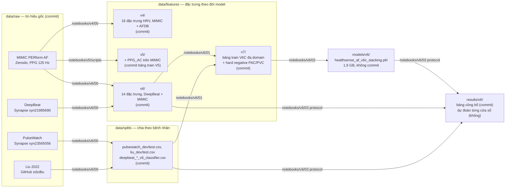

# HealthSense Machine Learning Lab

> **HealthSense Machine Learning** là kho nghiên cứu dành cho xử lý tín hiệu sinh lý, trích xuất đặc trưng và phát triển mô hình hỗ trợ **tầm soát rung nhĩ (Atrial Fibrillation, AF)** từ **quang thể tích ký (Photoplethysmography, PPG)**.  
> Trạng thái nghiên cứu hiện tại: **V6_RESEARCH_FREEZE_2026_09**.

> **Phạm vi lâm sàng:** hệ thống hỗ trợ **sàng lọc và cảnh báo dấu hiệu nghi ngờ rung nhĩ từ PPG**. Kết quả PPG không thay thế xác nhận bằng **điện tâm đồ (Electrocardiography, ECG)** và không phải chẩn đoán y khoa [8].

Đây là README duy nhất của repo: mọi mô tả thư mục con (`data/`, `notebooks/`, `src/`, `models/`, `results/`) đều nằm ở mục 8 và 9 bên dưới.

---

## Tiếng Việt

## 1. Trạng thái nghiên cứu hiện tại

Quá trình phát triển đã đi từ V4 → V5 → V6. Phiên bản hiện tại được đóng băng ở **V6 Research Freeze** để tránh tiếp tục tối ưu trên các benchmark đã được sử dụng nhiều lần và chuẩn bị cho external validation trên dữ liệu chưa từng tham gia training hoặc tuning.

### Mô hình nghiên cứu hiện tại

- **Model:** `HealthSense AF V6C Stacking`
- **Base models:** Extra Trees, Random Forest, XGBoost
- **Meta-model:** Logistic Regression
- **Input:** 14 đặc trưng trích xuất từ PPG
- **Primary output:** `meta_probability`
- **Calibration:** Platt scaling chỉ dùng cho phân tích, chưa được đưa vào runtime chính
- **Temporal alert candidate:** `v6_locked_global_rule_v2`
- **Current status:** dừng tuning trên các benchmark hiện tại; chờ untouched external validation

---

## 2. Bài toán nghiên cứu

HealthSense tập trung vào phát hiện dấu hiệu nghi ngờ AF từ PPG đeo tay.

```text
PPG waveform
    ↓
Signal preprocessing
    ↓
Beat detection
    ↓
NN interval series
    ↓
Heart Rate Variability features
    ↓
AF probability
    ↓
Temporal persistence rule
    ↓
Suspected-AF screening alert
```

Các thuật ngữ chính:

- **Heart Rate Variability (HRV):** biến thiên khoảng thời gian giữa các nhịp tim.
- **NN interval:** khoảng thời gian giữa các nhịp hợp lệ liên tiếp.
- **Signal Quality Index (SQI):** chỉ số chất lượng tín hiệu.
- **Premature Atrial Contraction (PAC):** ngoại tâm thu nhĩ.
- **Premature Ventricular Contraction (PVC):** ngoại tâm thu thất.

PAC và PVC là nhóm **hard negative** quan trọng vì có thể tạo kiểu nhịp bất thường gây nhầm với AF [5].

---

## 3. Hành trình V4 → V5 → V6

### V4 — sửa data leakage và xây baseline theo bệnh nhân

V4 sửa hai lỗi chính của các phiên bản đầu:

1. **Subject leakage:** các cửa sổ của cùng một bệnh nhân từng xuất hiện ở cả train và test.
2. **Preprocessing leakage:** scaler hoặc outlier filtering từng được fit trước khi chia dữ liệu.

V4 chuyển sang đánh giá theo bệnh nhân bằng **Leave-One-Subject-Out (LOSO)** và chỉ fit preprocessing trên training fold.

Dataset chính là **Medical Information Mart for Intensive Care (MIMIC) PERform AF** [1]:

- 35 đối tượng
- 19 AF
- 16 non-AF
- 4.130 cửa sổ PPG
- cửa sổ 30 giây, bước trượt 10 giây

V4 là baseline phương pháp luận, không còn là model nghiên cứu hiện tại, nhưng là **bản đang chạy trên AI-Service**: `models/v4/healthsense_afib_pipeline.pkl` (XGBoost, 13 đặc trưng HRV, pooled LOSO 60 bệnh nhân MIMIC + AFDB, AUROC 0,988).

---

### V5 — frozen single-domain model và external validation

V5 đóng băng một Random Forest sử dụng 14 đặc trưng, trong đó bổ sung đặc trưng tự tương quan PPG (`PPG_AC`).

Model:

```text
models/v5/healthsense_af_v5_rf_ac_frozen.pkl
```

Feature contract:

```text
HR_mean
Mean_NN
SDNN
RMSSD
NN50
pNN50
CV
HF
Total_Power
HF_norm
SD1
SD2
SampEn
PPG_AC
```

V5 được đánh giá trên nhiều nguồn dữ liệu bằng các script trong `notebooks/v5/scripts/` (notebook `notebooks/v5/02_external_validation.ipynb` gọi lần lượt):

| Script | Việc |
|---|---|
| `train_frozen_model.py` | Huấn luyện và đóng băng Random Forest 14 đặc trưng trên MIMIC → `models/v5/` (bản notebook: `notebooks/v5/01_train_frozen_rf.ipynb`) |
| `deepbeat_frozen_v5_external.py` | Chạy V5 trên DeepBeat [2] |
| `pulsewatch_frozen_v5_external.py` | Chạy V5 trên PulseWatch [3], kể cả cửa sổ PAC/PVC |
| `liu_pseudo30_frozen_v5.py` | Chạy V5 trên Liu 2022 [4] với cửa sổ giả 30 giây |
| `peakdet_pac_pvc_frozen_v5.py` | Bộ thử PAC/PVC hard negative [5] |
| `build_af_features.py`, `build_cosen_ac_features.py` | Dựng bảng train V5 `data/features/v5/af_features_cosen_ac.csv` từ đặc trưng V4 (thêm CoSEn, PPG_AC) |

Kết quả cho thấy AF so với nhịp xoang tương đối dễ hơn, trong khi PAC/PVC là hard-negative quan trọng. Đây là một trong các động lực chính để chuyển sang huấn luyện multidomain ở V6. Đặc trưng và dự đoán sinh ra ghi vào `results/v5/` (gitignore vì dẫn xuất từ dữ liệu Synapse).

Notebook: [HealthSense V5 Visual Review](notebooks/v5/review_visual.ipynb)

---

### V6 — multidomain, hard-negative aware và stacking

V6 mở rộng training sang nhiều domain và đưa hard negatives vào quá trình phát triển.

Các model từng được benchmark:

- Random Forest
- Extra Trees
- XGBoost
- LightGBM
- CatBoost
- Histogram Gradient Boosting

V6C giữ ba base learner:

```text
Extra Trees
Random Forest
XGBoost
    ↓
Logistic Regression meta-model
    ↓
meta_probability
```

### Reused subject-held-out benchmark

Các test split dưới đây tách theo subject nhưng đã được inspect nhiều lần trong quá trình nghiên cứu. Vì vậy chúng được gọi là **reused subject-held-out benchmark**, không phải pristine external validation.

| Dataset | Area Under Receiver Operating Characteristic Curve (AUROC) | Area Under Precision-Recall Curve (PR-AUC) | Brier score |
|---|---:|---:|---:|
| DeepBeat | 0.9904 | 0.9890 | 0.0583 |
| PulseWatch | 0.9985 | 0.9890 | 0.0095 |
| Liu | 0.9866 | 0.9780 | 0.0322 |

Notebook: [HealthSense V6 Research Freeze Visual Review](notebooks/v6/review_visual.ipynb)

---

## 4. Protocol đánh giá khoá của V6 (nguồn số liệu công bố)

Sau các thử nghiệm temporal V6D–V6H, phần đánh giá cuối được reset sang protocol khoá gồm 18 script trong `notebooks/v6/protocol/`, chạy **đúng thứ tự số** từ gốc repo (notebook `notebooks/v6/03_locked_protocol.ipynb` gọi lần lượt). Cần có trước `models/v6/healthsense_af_v6c_stacking.pkl`, `data/features/v6/` và `data/splits/`. Tham số dò trên DEV được đóng băng kèm SHA-256 trước khi chạm TEST. Đầu ra ghi vào `results/v6/`.

| # | Script | Việc | Đầu ra chính |
|---|---|---|---|
| 01 | `generate_locked_predictions.py` | Dự đoán của V6C trên DEV, TEST của ba domain | `*_locked_predictions.csv` (gitignore) |
| 02 | `audit_temporal_and_splits.py` | Kiểm tra thứ tự thời gian và không trùng bệnh nhân | `*_temporal_order_audit.csv` |
| 03 | `build_verified_streams.py` | Chuỗi cửa sổ liên tục đã xác minh cho từng bệnh nhân | `*_verified_streams.csv` |
| 04 | `tune_global_rule_dev.py` | Dò luật cảnh báo V1 trên DEV | `FROZEN_GLOBAL_RULE.json` |
| 05 | `evaluate_frozen_rule_test.py` | Chấm luật V1 trên TEST | |
| 06 | `tune_global_rule_v2_dev.py` | Dò Global rule V2 (p ≥ 0,8, bất định ≤ 0,05, 5 cửa sổ; rescue 0,9 và 2) | `FROZEN_GLOBAL_RULE_V2.json` |
| 07 | `evaluate_global_rule_v2_test.py` | Chấm V2 trên TEST ở mức bệnh nhân | `global_rule_v2_reused_test_summary.csv` |
| 08 | `calibration_diagnostics.py` | Platt scaling fit trên DEV, Brier và LogLoss trước, sau | `FROZEN_PLATT_CALIBRATOR.json`, `calibration_summary.csv` |
| 09 | `subject_cluster_bootstrap.py` | Khoảng tin cậy mức cửa sổ bằng bootstrap theo cụm bệnh nhân | `window_metrics_subject_cluster_bootstrap.csv` |
| 10 | `exact_subject_ci.py` | Khoảng tin cậy Wilson và exact ở mức bệnh nhân | `global_rule_v2_exact_subject_ci.csv` |
| 11 | `lodo_domain_generalization.py` | Leave-One-Domain-Out, huấn luyện lại 4 lần | `lodo_*_summary.json` |
| 12 | `collect_lodo_results.py` | Gom LODO thành một bảng | `lodo_domain_generalization_summary.csv` |
| 13 | `ppg_ac_ablation_dev.py` | 13 so với 14 đặc trưng trên DEV | `ppg_ac_ablation_dev_*.csv` |
| 14 | `pac_pvc_challenge.py` | Tỉ lệ báo nhầm trên bộ PAC/PVC | `pac_pvc_challenge_summary.csv` |
| 15 | `deepbeat_lodo_forensics.py` | Vì sao LODO DeepBeat kém: FN so với TP | `deepbeat_lodo_*.csv` |
| 16 | `deepbeat_domain_exposure.py` | Thêm bệnh nhân DeepBeat vào train thì được gì | `deepbeat_domain_exposure_summary.csv` |
| 17 | `deepbeat_lodo_ppg_ac_ablation.py` | PPG_AC trên LODO DeepBeat | `deepbeat_lodo_ppg_ac_ablation_*.csv` |
| 18 | `finalize_v6_research_freeze.py` | Chốt freeze, ghi SHA-256 mọi hiện vật | `V6_RESEARCH_FREEZE.md`, `V6_RESEARCH_FREEZE_SHA256.csv` |

Các bảng tổng hợp trong `results/v6/` được commit và là nguồn số liệu của bài báo; dự đoán từng cửa sổ và verified streams thì không. Notebook `review_visual` đọc từ đây.

### Global Rule V2

Global Rule V2 gồm hai nhánh:

- **Base rule:** probability ≥ 0.80, model disagreement ≤ 0.05, ít nhất 5 cửa sổ liên tiếp
- **Rescue rule:** probability ≥ 0.90, model disagreement ≤ 0.05, ít nhất 2 cửa sổ liên tiếp

`ensemble_std` là độ lệch chuẩn giữa probability của các base model và chỉ được hiểu là **model disagreement**, không phải calibrated uncertainty.

Global Rule V2 hiện là exploratory candidate cho untouched external validation.

---

## 5. Leave-One-Domain-Out domain-generalization analysis

**Leave-One-Domain-Out (LODO)** giữ toàn bộ một dataset làm held-out domain và train trên các domain còn lại.

| Held-out domain | AUROC | PR-AUC | Brier score |
|---|---:|---:|---:|
| DeepBeat | 0.8384 | 0.8289 | 0.1898 |
| PulseWatch | 0.9877 | 0.9417 | 0.0560 |
| Liu | 0.9797 | 0.9599 | 0.0500 |
| MIMIC PERform | 0.9856 | 0.9867 | 0.0530 |

DeepBeat cho thấy domain shift rõ rệt và là failure mode quan trọng cần theo dõi.

LODO trong repo là **retrospective domain-generalization analysis**, không phải pristine external validation.

---

## 6. PPG_AC, calibration và hard negatives

### PPG_AC ablation

Matched development ablation:

| Variant | Macro AUROC | Macro PR-AUC | Macro Brier |
|---|---:|---:|---:|
| 13 features, không `PPG_AC` | 0.9154 | 0.6175 | 0.0729 |
| 14 features, có `PPG_AC` | 0.9263 | 0.6693 | 0.0607 |

Kết quả tổng thể hỗ trợ giữ `PPG_AC`, nhưng không đồng nghĩa đặc trưng này giải quyết toàn bộ domain shift.

### Calibration

Platt calibration được đánh giá bằng development-only grouped cross-validation nhưng không cải thiện nhất quán trên mọi domain.

Vì vậy:

- `meta_probability` thô vẫn là probability chính
- Platt scaling chỉ dùng cho analysis
- runtime không tự động áp dụng calibration

### PAC/PVC challenge

PAC/PVC được theo dõi riêng vì đây là nguồn false positive quan trọng ở cấp cửa sổ. Các nghiên cứu smartwatch PPG trước đây cũng chỉ ra rằng PAC/PVC có thể làm giảm độ đặc hiệu của AF screening nếu không được xử lý riêng [5].

---

## 7. Datasets

### Dataset đã dùng trong quá trình phát triển

| Dataset | Vai trò trong HealthSense | Tín hiệu / nhãn chính | Link truy cập |
|---|---|---|---|
| **MIMIC PERform AF** [1] | V4 baseline, V5/V6 reference domain | PPG + ECG; AF / non-AF | [Dataset documentation](https://ppg-beats.readthedocs.io/en/latest/datasets/mimic_perform_af/) · [Zenodo](https://zenodo.org/records/6973963) |
| **DeepBeat** [2] | V5 external evaluation, V6 multidomain | wearable PPG; AF + signal quality | [Dataset: Synapse `syn21985690`](https://www.synapse.org/Synapse:syn21985690) · [Code](https://github.com/AshleyLab/deepbeat) |
| **PulseWatch** [3] | V5/V6 external and hard-negative evaluation | smartwatch PPG + reference ECG; AF, normal sinus rhythm, PAC/PVC | [Dataset: Synapse `syn23565056`](https://www.synapse.org/Synapse:syn23565056) |
| **Liu 2022** [4] | V5/V6 multiclass external evaluation | PPG; sinus rhythm, PVC, PAC, ventricular tachycardia, supraventricular tachycardia, AF | [Dataset + code](https://github.com/zdzdliu/PPGArrhythmiaDetection) |
| **Selected MIMIC-III / PAC-PVC challenge data** [5] | targeted PAC/PVC hard-negative challenge | fingertip PPG; AF, PAC/PVC, normal sinus rhythm | [UConn resource / Synapse access](https://biosignal.uconn.edu/resources/) |

### Dataset dành cho untouched external validation

| Dataset | Trạng thái trong HealthSense | Link |
|---|---|---|
| **MIMIC-III-Ext-PPG v1.1.0** [6] | Chưa dùng cho training, tuning hoặc current benchmark | [PhysioNet](https://physionet.org/content/mimic-iii-ext-ppg/1.1.0/) · [Official code/documentation](https://github.com/AI4HealthUOL/MIMIC-III-Ext-PPG_dataset) |
| **TriggersAF** [7] | Chưa dùng; dự kiến làm external validation khi có quyền truy cập phù hợp | [Project page](https://biomedicine.ktu.edu/projects/wearable-technology-for-personalized-identification-and-management-of-paroxysmal-atrial-fibrillation-triggers-triggersaf/) |

> **MIMIC-III-Ext-PPG** là credentialed-access dataset trên PhysioNet. Quyền truy cập yêu cầu credentialing, Data Use Agreement và khóa đào tạo nghiên cứu dữ liệu người theo yêu cầu của PhysioNet [6].

---

## 8. Dữ liệu trong repo (`data/`)

Thư mục `data/` đi theo dòng chảy **tín hiệu thô → đặc trưng → tập chia theo bệnh nhân**. `data/MANIFEST.csv` (sinh bằng `python -m healthsense_ml.manifest`, chạy từ gốc repo với `PYTHONPATH=src`) liệt kê kích thước và SHA-256 của mọi tệp trong `data/`, `results/v6/`, `models/` để đối chiếu khi chép giữa các máy.



| Thư mục | Nội dung | Sinh bởi | Commit? |
|---|---|---|---|
| `raw/mimic_perform/` | PPG + ECG gốc, 35 bệnh nhân, `af/` và `non-af/` | [Zenodo 6973963](https://zenodo.org/records/6973963) | **Có** |
| `raw/deepbeat/`, `raw/pulsewatch/`, `raw/liu2022/` | PPG gốc của ba domain còn lại | Synapse (cần tài khoản và DUA), GitHub zdzdliu | Chưa có trên máy này; tải về thì commit |
| `cache/` | memmap tín hiệu DeepBeat để trích đặc trưng nhanh | `notebooks/v6/00` | Có khi sinh ra |
| `features/v4/` | `mimic_features_v4.csv`, `afdb_features_v4.csv`: 16 đặc trưng HRV cửa sổ 30 s | `notebooks/v4/00` (`src/healthsense_ml`) | **Có** |
| `features/v5/` | `af_features_cosen_ac.csv`: bảng train V5 trên MIMIC, thêm PPG_AC (commit); `af_specific_features.csv` trung gian và `afdb_features_v5_afib_only.csv` (không) | `notebooks/v5/scripts/build_*`, `src/healthsense_ml/afdb.py` | **Có** |
| `features/v6/` | DeepBeat train/validate/test và MIMIC, 14 đặc trưng (13 HRV + PPG_AC) | `notebooks/v6/00` | **Có** |
| `features/v7/` | `healthsense_af_v6c_pacaware_train.csv` (137 476 cửa sổ, 248 bệnh nhân, 4 domain), `hard_negative_v7_v2.csv`, bảng V6B | `notebooks/v6/00`, `notebooks/v6/01` | **Có** |
| `splits/` | DEV/TEST theo bệnh nhân của PulseWatch và Liu (kèm seed), manifest cửa sổ DeepBeat, SHA-256 nguồn | `notebooks/v6/00` | **Có** |
| `sample/` | Vài tệp nhỏ để chạy thử | Cắt từ MIMIC | **Có** |

**Toàn bộ `data/` được commit** (khoảng 475 MB, không tệp nào quá 50 MB): tín hiệu thô MIMIC, đặc trưng mọi đời, tập chia theo bệnh nhân. Chỉ `*_rebuilt.csv` (đầu ra khi chạy lại notebook) bị ignore. Lưu ý đặc trưng V6/V7 và `splits/` dẫn xuất từ DeepBeat, PulseWatch trên Synapse; khi công khai repo cần xem lại thoả thuận sử dụng dữ liệu của hai bộ đó.

**Tái tạo từ đầu:**

1. `data/raw/mimic_perform/` đã có trong repo; xin quyền Synapse cho DeepBeat và PulseWatch; clone Liu 2022.
2. `notebooks/v4/00_prepare_features` → `data/features/v4/`.
3. `notebooks/v5/01_train_frozen_rf` → model V5; `notebooks/v5/02_external_validation` → `results/v5/` (đầu vào cho bước sau).
4. `notebooks/v6/00_extract_features_and_splits` → `data/features/v6/`, `data/splits/`; `notebooks/v6/01` → `data/features/v7/`; `notebooks/v6/02` → model V6C.
5. `notebooks/v6/03_locked_protocol` → `results/v6/`.
6. `python -m healthsense_ml.manifest` và so với `MANIFEST.csv` đã commit.

Máy hiện tại **chưa có** `raw/` của ba domain ngoài MIMIC, nên bước 3 (kiểm định ngoài) và 4 (trích đặc trưng) chỉ chạy được trên máy đã tải dữ liệu; `results/v5` ở đây là bản chép từ máy đó.

---

## 9. Cấu trúc repository

```text
HealthSense-MachineLearning-Lab/
├── data/                 # raw/ MIMIC, features/v4..v7, splits/ (DEV/TEST theo bệnh nhân), MANIFEST.csv — tất cả commit, mục 8
├── notebooks/            # mỗi phiên bản một thư mục, chạy theo số: v4/ v5/ v6/ (+ scripts/, v6/protocol/)
├── src/healthsense_ml/   # thư viện dùng chung: lọc, dò nhịp, 16 đặc trưng HRV, manifest
├── models/               # v4/ (pkl triển khai + model card, commit), v5/, v6/ (chỉ commit thẻ JSON, pkl lấy theo MANIFEST)
└── results/              # v4/, v5/, v6/ (số liệu công bố)
```

### 9.1 `notebooks/` — mỗi phiên bản model một thư mục, chạy theo số thứ tự

| Thư mục | Chuỗi notebook | Sinh ra |
|---|---|---|
| `v4/` | `00_prepare_features` → `01_evaluate_loso_cross_dataset` → `02_train_pooled_model` | `data/features/v4/`, kết quả LOSO và cross-dataset ở `results/v4/`, model `models/v4/` (bản AI-Service đang dùng; notebook ghi `_retrained` trừ khi bật `OVERWRITE_FROZEN`) |
| `v5/` | `01_train_frozen_rf` → `02_external_validation` → `review_visual` | model V5 ở `models/v5/`, kết quả kiểm định ngoài ở `results/v5/` |
| `v6/` | `00_extract_features_and_splits` → `01_prepare_training_table` → `02_train_stacking` → `03_locked_protocol` → `review_visual` | `data/features/v6,v7/`, `data/splits/`, model V6C ở `models/v6/`, số liệu công bố ở `results/v6/` |

Mỗi thư mục phiên bản có `scripts/` (các bước dài, notebook gọi bằng `run(...)`); riêng `v6/protocol/` là 18 script của protocol khoá (mục 4). Mọi notebook tự tìm gốc repo nên mở từ đâu cũng chạy; môi trường là `venv/` của repo. Notebook huấn luyện mặc định ghi `*_retrained` hoặc `*_rebuilt`, chỉ ghi đè hiện vật đóng băng khi bật `OVERWRITE_FROZEN` / `OVERWRITE`. Những bước cần dữ liệu Synapse (V5 kiểm định ngoài, V6 trích đặc trưng, protocol) chỉ chạy được trên máy đã tải dữ liệu đó.

Chạy không cần giao diện:

```bash
venv\Scripts\jupyter nbconvert --to notebook --execute --inplace notebooks/v6/02_train_stacking.ipynb
```

### 9.2 `src/healthsense_ml/` — thư viện dùng chung

Đây là **định nghĩa gốc** của phép đo: lọc tín hiệu, dò nhịp, chuỗi NN và 16 đặc trưng HRV (13 đặc trưng dùng huấn luyện sau khi bỏ nhóm LF). `HealthSense-AI-Service/app/services/hrv_v4.py` là bản sao được kiểm tra tương đương bằng `tests/parity_check.py` bên service; sửa một bên thì phải chạy lại parity. Ba module 1, 3, 5 là phần AI-Service import trực tiếp; không đổi chữ ký hàm của chúng.

| # | Module | Việc |
|---|---|---|
| 1 | `config.py` | Hằng số: 125 Hz, dải lọc 0,5–8 Hz, cửa sổ 30 s bước 10 s, danh sách đặc trưng, đường dẫn `data/`, `models/`, `results/` |
| 2 | `data_loading.py` | Nạp PPG thô MIMIC PERform AF từ `data/raw/mimic_perform/` |
| 3 | `signal_processing.py` | Lọc bandpass → dò nhịp theo z-score → chuỗi NN trong giới hạn sinh lý |
| 4 | `beat_validation.py` | Chấm bộ dò nhịp PPG bằng R-peak của ECG ghi song song |
| 5 | `hrv_features.py` | Chuỗi NN → 16 đặc trưng HRV theo Task Force 1996 (thời gian, tần số, Poincaré, SampEn) |
| 6 | `feature_extraction.py` | Cắt cửa sổ trượt và gom bảng đặc trưng `data/features/v4/mimic_features_v4.csv` |
| 7 | `afdb.py` | Cùng pipeline cho MIT-BIH AFDB (ECG) → `data/features/v5/afdb_features_v5_afib_only.csv` |
| 8 | `training.py` | Registry model và lưới tham số, mặt nạ IQR chỉ fit trên train |
| 9 | `evaluation.py` | LOSO, metric hai mức cửa sổ và bệnh nhân |
| 10 | `manifest.py` | Sinh `data/MANIFEST.csv` (SHA-256 của dữ liệu và model), chạy `python -m healthsense_ml.manifest` |

Phần V5 và V6 (PPG_AC, đa domain, stacking) không nằm ở đây mà trong `notebooks/v5/` và `notebooks/v6/` (kèm `scripts/`), vì chúng có tham số đóng băng riêng; chúng vẫn import thư viện này để tính đặc trưng. Bảo tàng phiên bản v1–v4 cũ (`src/v1..v4`, `src/vlab`, `src/report`) đã gỡ khỏi repo; lịch sử còn trong git.

### 9.3 `models/` — model nạp được vào chương trình, mỗi phiên bản một thư mục

| Thư mục | Model | Commit? | Sinh bởi |
|---|---|---|---|
| `v4/` | `healthsense_afib_pipeline.pkl` (248 KB): sklearn Pipeline `StandardScaler → XGBClassifier`, 13 đặc trưng HRV theo thứ tự trong `model_card.json`, train trên 60 bệnh nhân MIMIC + AFDB có cân bằng nguồn. **Đây là bản AI-Service đang chạy** (`HealthSense-AI-Service/app/models/`, sao chép từng byte) | pkl + JSON | `notebooks/v4/02_train_pooled_model` |
| `v5/` | `healthsense_af_v5_rf_ac_frozen.pkl` (1 MB): Random Forest 14 đặc trưng (thêm PPG_AC), đóng băng trên MIMIC; kèm `.json` và `.sha256` | chỉ JSON, SHA | `notebooks/v5/01_train_frozen_rf` |
| `v6/` | `healthsense_af_v6c_stacking.pkl` (1,9 GB): Extra Trees + Random Forest + XGBoost → Logistic Regression meta, 137 476 cửa sổ / 248 bệnh nhân / 4 domain; kèm `.json`. Thẻ JSON của V6A, V6B giữ lại để đối chiếu lịch sử | chỉ JSON | `notebooks/v6/02_train_stacking`; bản chuẩn xin từ máy đã train, đối chiếu SHA-256 trong `data/MANIFEST.csv` |

Ba quy tắc:

1. **Scaler nằm trong Pipeline.** AI-Service từng nhận một `MLPClassifier` trần (`best_model_8165.pkl`) không kèm scaler và cho kết quả rác mà không báo lỗi; `load_model()` bên đó nay từ chối model không đóng gói tiền xử lý.
2. **Thẻ JSON cạnh mỗi pkl** ghi phiên bản, danh sách đặc trưng đúng thứ tự và số liệu thật (các đời v1–v3 từng bị thổi phồng 6–7 điểm vì data leakage).
3. **Notebook train không đè bản đóng băng.** Mặc định ghi `*_retrained.pkl` / `*_retrained.json` cạnh bản chuẩn để so sánh; chỉ ghi đè khi bật `OVERWRITE_FROZEN`. Muốn thay bản triển khai V4 thì bật cờ, chạy lại, rồi chép sang AI-Service và chạy `tests/parity_check.py` bên đó.

### 9.4 `results/` — số liệu đã sinh, chia theo phiên bản

| Thư mục | Nội dung | Sinh bởi |
|---|---|---|
| `v4/` | `benchmark_v4/` LOSO 35 bệnh nhân MIMIC, `cross_dataset/` MIMIC ↔ AFDB, `beat_validation/` dò nhịp so với R-peak ECG, `pooled_loso_*` 60 bệnh nhân | `notebooks/v4/` |
| `v5/` | Bảng tóm tắt, đặc trưng và dự đoán khi kiểm định ngoài V5 (toàn bộ ignore, dẫn xuất từ Synapse) | `notebooks/v5/02_external_validation` |
| `v6/` | Số liệu công bố: cửa sổ, LODO, Global rule V2, Platt, PAC/PVC, SHA-256 của freeze (commit); dự đoán từng cửa sổ và verified streams (ignore) | `notebooks/v6/03_locked_protocol` |

---

## 10. Cài đặt và chạy

Môi trường của repo là `venv/` (Python 3.10 trở lên):

```bash
python -m venv venv
venv\Scripts\activate
pip install -r requirements.txt
jupyter lab notebooks/
```

Linux/macOS thay dòng kích hoạt bằng `source venv/bin/activate`. Script trong `notebooks/*/scripts/` và `notebooks/v6/protocol/` chạy từ gốc repo với `PYTHONPATH=src` (notebook runner tự đặt). Một số bước như LODO, ablation và bootstrap có thể tốn thời gian. Không nên tuning tiếp trên các benchmark hiện tại nếu mục tiêu là giữ tính độc lập cho bước validation tiếp theo.

---

## 11. Giới hạn nghiên cứu

- PPG screening không thay thế ECG confirmation [8].
- Các reused subject-held-out benchmarks đã được inspect nhiều lần.
- LODO là retrospective analysis.
- DeepBeat cho thấy domain shift đáng kể.
- PAC/PVC vẫn là hard-negative quan trọng.
- Temporal rule cần validation trên dataset hoàn toàn chưa dùng.
- Signal Quality Index chưa phải end-to-end gate cuối cùng của production pipeline.
- V6C hiện phù hợp research/server-side runtime hơn edge deployment.
- Chưa có clinical validation trên wearable HealthSense thực tế.

---

## 12. Hướng tiếp theo

1. Giữ nguyên V6 freeze, không tuning tiếp trên benchmark hiện tại.
2. Untouched external validation trên MIMIC-III-Ext-PPG khi được cấp quyền.
3. Untouched external validation trên TriggersAF khi có quyền truy cập phù hợp.
4. Đánh giá Signal Quality Index end-to-end.
5. Chuẩn hóa temporal stride và session semantics.
6. Báo cáo subject-level sensitivity, specificity và false alerts per hour.
7. Nếu phát triển V7, sử dụng dữ liệu hoặc hypothesis mới và yêu cầu một untouched validation set mới.

---

# English

## Current research status

HealthSense Machine Learning develops **Photoplethysmography (PPG)-based screening for suspected Atrial Fibrillation (AF)**.

Current frozen research candidate:

**V6_RESEARCH_FREEZE_2026_09**

Current model:

**HealthSense AF V6C Stacking**

```text
Extra Trees
Random Forest
XGBoost
    ↓
Logistic Regression meta-model
    ↓
raw meta_probability
```

The model uses 14 PPG-derived features, including `PPG_AC`.

The existing subject-held-out test datasets have been repeatedly inspected and are therefore reported as **reused subject-held-out benchmarks**, not pristine external validation.

**Leave-One-Domain-Out (LODO)** evaluation is treated as retrospective domain-generalization analysis.

Future untouched external validation is reserved for:

- MIMIC-III-Ext-PPG
- TriggersAF

The system is intended for suspected-AF screening and early warning. It does not replace **Electrocardiography (ECG)-based confirmation** [8].

## Main results

### V6C reused subject-held-out benchmark

| Dataset | Area Under Receiver Operating Characteristic Curve (AUROC) | Area Under Precision-Recall Curve (PR-AUC) | Brier score |
|---|---:|---:|---:|
| DeepBeat | 0.9904 | 0.9890 | 0.0583 |
| PulseWatch | 0.9985 | 0.9890 | 0.0095 |
| Liu | 0.9866 | 0.9780 | 0.0322 |

### Retrospective Leave-One-Domain-Out analysis

| Held-out domain | AUROC | PR-AUC | Brier score |
|---|---:|---:|---:|
| DeepBeat | 0.8384 | 0.8289 | 0.1898 |
| PulseWatch | 0.9877 | 0.9417 | 0.0560 |
| Liu | 0.9797 | 0.9599 | 0.0500 |
| MIMIC PERform | 0.9856 | 0.9867 | 0.0530 |

DeepBeat exposes a substantial domain shift and remains an important failure mode.

## Dataset access

| Dataset | Use in this repository | Access |
|---|---|---|
| MIMIC PERform AF [1] | baseline and reference domain | [Documentation](https://ppg-beats.readthedocs.io/en/latest/datasets/mimic_perform_af/) |
| DeepBeat [2] | external and multidomain evaluation | [Synapse `syn21985690`](https://www.synapse.org/Synapse:syn21985690) |
| PulseWatch [3] | smartwatch PPG and hard-negative evaluation | [Synapse `syn23565056`](https://www.synapse.org/Synapse:syn23565056) |
| Liu 2022 [4] | multiclass arrhythmia external evaluation | [GitHub dataset](https://github.com/zdzdliu/PPGArrhythmiaDetection) |
| Selected MIMIC-III PAC/PVC data [5] | targeted hard-negative challenge | [UConn resources](https://biosignal.uconn.edu/resources/) |
| MIMIC-III-Ext-PPG v1.1.0 [6] | future untouched external validation | [PhysioNet](https://physionet.org/content/mimic-iii-ext-ppg/1.1.0/) |
| TriggersAF [7] | future untouched external validation | [Project page](https://biomedicine.ktu.edu/projects/wearable-technology-for-personalized-identification-and-management-of-paroxysmal-atrial-fibrillation-triggers-triggersaf/) |

## Reproducibility

Each model version has its own numbered notebook chain under `notebooks/v4/`, `notebooks/v5/`, `notebooks/v6/`; long steps live in the adjacent `scripts/` folders and the 18-step locked protocol in `notebooks/v6/protocol/` (see section 4). Shared signal-processing and feature code is `src/healthsense_ml/`.

Large generated feature matrices, row-level predictions and V6 model binaries are intentionally not stored in normal Git history; `data/MANIFEST.csv` carries their SHA-256.

Main notebooks:

- [V5 Visual Review](notebooks/v5/review_visual.ipynb)
- [V6 Research Freeze Visual Review](notebooks/v6/review_visual.ipynb)

---

## References

1. **Charlton PH, et al.** Detecting beats in the photoplethysmogram: benchmarking open-source algorithms. *Physiological Measurement*. 2022. DOI: [10.1088/1361-6579/ac826d](https://doi.org/10.1088/1361-6579/ac826d). Dataset: [MIMIC PERform AF](https://ppg-beats.readthedocs.io/en/latest/datasets/mimic_perform_af/).

2. **Torres-Soto J, Ashley EA.** Multi-task deep learning for cardiac rhythm detection in wearable devices. *npj Digital Medicine*. 2020;3:116. DOI: [10.1038/s41746-020-00320-4](https://doi.org/10.1038/s41746-020-00320-4). Dataset/code: [DeepBeat](https://github.com/AshleyLab/deepbeat), Synapse `syn21985690`.

3. **Han D, Moon J, Mercado Díaz LR, et al.** Multiclass Arrhythmia Classification Using Multimodal Smartwatch Photoplethysmography Signals Collected in Real-Life Settings. *IEEE Transactions on Biomedical Engineering*. 2026;73(4):1679-1693. DOI: [10.1109/TBME.2025.3613471](https://doi.org/10.1109/TBME.2025.3613471). Dataset: [PulseWatch, Synapse `syn23565056`](https://www.synapse.org/Synapse:syn23565056).

4. **Liu Z, Zhou B, Jiang Z, et al.** Multiclass Arrhythmia Detection and Classification From Photoplethysmography Signals Using a Deep Convolutional Neural Network. *Journal of the American Heart Association*. 2022;11(7):e023555. DOI: [10.1161/JAHA.121.023555](https://doi.org/10.1161/JAHA.121.023555). Dataset/code: [PPGArrhythmiaDetection](https://github.com/zdzdliu/PPGArrhythmiaDetection).

5. **Han D, Bashar SK, Mohagheghian F, et al.** Premature Atrial and Ventricular Contraction Detection Using Photoplethysmographic Data from a Smartwatch. *Sensors*. 2020;20(19):5683. DOI: [10.3390/s20195683](https://doi.org/10.3390/s20195683). Related UConn/Synapse resources: [Biosignal Processing and Wearable Device Lab](https://biosignal.uconn.edu/resources/).

6. **Moulaeifard M, Charlton PH, Strodthoff N.** MIMIC-III-Ext-PPG: A PPG Benchmark Dataset for Cardiorespiratory Analysis, version 1.1.0. *PhysioNet*. 2026. DOI: [10.13026/r6k1-xt76](https://doi.org/10.13026/r6k1-xt76). Dataset: [PhysioNet](https://physionet.org/content/mimic-iii-ext-ppg/1.1.0/). See also: Moulaeifard M, Kutscher M, Aston PJ, et al. *Scientific Data*. 2026;13:668. DOI: [10.1038/s41597-026-07335-8](https://doi.org/10.1038/s41597-026-07335-8).

7. **TriggersAF project.** Wearable technology for personalized identification and management of paroxysmal atrial fibrillation triggers. Kaunas University of Technology / Vilnius University. Project page: [TriggersAF](https://biomedicine.ktu.edu/projects/wearable-technology-for-personalized-identification-and-management-of-paroxysmal-atrial-fibrillation-triggers-triggersaf/). Related clinical publication: Bacevičius J, et al. *EP Europace*. 2025;27(Suppl 1). DOI: [10.1093/europace/euaf085.262](https://doi.org/10.1093/europace/euaf085.262).

8. **Van Gelder IC, Rienstra M, Bunting KV, et al.** 2024 European Society of Cardiology Guidelines for the management of atrial fibrillation developed in collaboration with the European Association for Cardio-Thoracic Surgery. *European Heart Journal*. 2024;45(36):3314-3414. DOI: [10.1093/eurheartj/ehae176](https://doi.org/10.1093/eurheartj/ehae176).

### Tài liệu nền (background references)

Các tài liệu dưới đây không được trích dẫn trực tiếp trong phần trên nhưng là cơ sở cho lựa chọn đặc trưng HRV, việc dùng PPG thay ECG và hướng phát hiện AF bằng thiết bị đeo. Đánh số tiếp theo [1]–[8].

**Cơ sở lý thuyết HRV.** Định nghĩa 16 đặc trưng HRV (SDNN, RMSSD, pNN50, LF, HF, LF/HF, Poincaré) và chuẩn đo lường mà `src/healthsense_ml/hrv_features.py` theo.

9. **Task Force of the European Society of Cardiology and the North American Society of Pacing and Electrophysiology.** Heart rate variability: standards of measurement, physiological interpretation and clinical use. *European Heart Journal*. 1996;17(3):354-381. DOI: [10.1093/oxfordjournals.eurheartj.a014868](https://doi.org/10.1093/oxfordjournals.eurheartj.a014868).
10. **Shaffer F, Ginsberg JP.** An overview of heart rate variability metrics and norms. *Frontiers in Public Health*. 2017;5:258. DOI: [10.3389/fpubh.2017.00258](https://doi.org/10.3389/fpubh.2017.00258).
11. **Malik M, et al.** Heart rate variability in relation to prognosis after myocardial infarction: selection of optimal processing techniques. *European Heart Journal*. 1989;10(12):1060-1074. DOI: [10.1093/oxfordjournals.eurheartj.a059575](https://doi.org/10.1093/oxfordjournals.eurheartj.a059575).

**PPG đo HRV chính xác tới đâu so với ECG.** Lý do chuỗi NN từ PPG dùng được cho đặc trưng vốn định nghĩa trên ECG.

12. **Schäfer A, Vagedes J.** How accurate is pulse rate variability as an estimate of heart rate variability? A review on studies comparing photoplethysmographic technology with an electrocardiogram. *International Journal of Cardiology*. 2013;166(1):15-29. DOI: [10.1016/j.ijcard.2012.09.119](https://doi.org/10.1016/j.ijcard.2012.09.119). Khi nghỉ, PPG và ECG tương quan r > 0,99.
13. **Georgiou K, et al.** Can wearable devices accurately measure heart rate variability? A systematic review. *Folia Medica*. 2018;60(1):7-20. DOI: [10.2478/folmed-2018-0012](https://doi.org/10.2478/folmed-2018-0012). RMSSD và SDNN sai lệch dưới 5% so với ECG khi ít vận động.
14. **Bent B, et al.** Investigating sources of inaccuracy in wearable optical heart rate sensors. *npj Digital Medicine*. 2020;3:18. DOI: [10.1038/s41746-020-0226-6](https://doi.org/10.1038/s41746-020-0226-6). Độ chính xác phụ thuộc màu da, vận động, vị trí đeo.
15. **Charlot K, et al.** Interchangeability of heart rate variability measured by PPG and ECG. *Sensors*. 2022;22(13):4984. DOI: [10.3390/s22134984](https://doi.org/10.3390/s22134984). ICC > 0,90 khi nghỉ.
16. **Peralta E, et al.** Assessing the quality of heart rate variability estimated from wrist and finger PPG: a novel approach based on cross-mapping method. *Sensors*. 2019;19(16):3552. DOI: [10.3390/s19163552](https://doi.org/10.3390/s19163552). PPG ngón tay gần HRV từ ECG hơn PPG cổ tay.
17. **Fine J, et al.** Sources of inaccuracy in photoplethysmography for continuous cardiovascular monitoring. *Biosensors*. 2021;11(4):126. DOI: [10.3390/bios11040126](https://doi.org/10.3390/bios11040126). Pulse transit time gây dịch pha nhưng không ảnh hưởng khoảng RR.

| Điều kiện | Tương quan PPG so với ECG | Nguồn |
|---|---|---|
| Ngồi, nằm nghỉ | ICC > 0,90; r > 0,99 | [12] [13] [15] |
| Đi bộ nhẹ | ICC khoảng 0,85; sai lệch 5–10% | [13] [14] |
| Vận động mạnh | ICC giảm; sai lệch 15–20% | [14] |

**Phát hiện AF bằng PPG trên thiết bị đeo.** Bằng chứng rằng bài toán khả thi ở quy mô lớn và mốc hiệu năng để so sánh.

18. **Perez MV, et al.** Large-scale assessment of a smartwatch to identify atrial fibrillation (Apple Heart Study). *New England Journal of Medicine*. 2019;381:1909-1917. DOI: [10.1056/NEJMoa1901183](https://doi.org/10.1056/NEJMoa1901183). PPV 84% trên 419 297 người.
19. **Bumgarner JM, et al.** Smartwatch algorithm for automated detection of atrial fibrillation. *Journal of the American College of Cardiology*. 2018;71(21):2381-2388. DOI: [10.1016/j.jacc.2018.03.003](https://doi.org/10.1016/j.jacc.2018.03.003). Sensitivity 93%, specificity 84%.
20. **Mannhart D, et al.** Clinical validation of 5 direct-to-consumer wearable smart devices to detect atrial fibrillation (BASEL Wearable Study). *JACC: Clinical Electrophysiology*. 2023;9(2):232-242. DOI: [10.1016/j.jacep.2022.09.011](https://doi.org/10.1016/j.jacep.2022.09.011).
21. **Düking P, et al.** Use of a smart watch for early detection of paroxysmal atrial fibrillation: validation study. *JMIR Cardio*. 2020;4(1):e14857. DOI: [10.2196/14857](https://doi.org/10.2196/14857).
22. Accuracy of smartwatches in the detection of atrial fibrillation: systematic review and meta-analysis. 2025. [PMC11737279](https://www.ncbi.nlm.nih.gov/pmc/articles/PMC11737279/). Sensitivity và specificity gộp trên 90%.

**Dữ liệu ECG công khai.** Dùng để kiểm định chéo: ECG → khoảng RR → cùng không gian đặc trưng HRV với PPG.

23. **MIT-BIH Atrial Fibrillation Database** (AFDB). PhysioNet. [physionet.org/content/afdb/1.0.0](https://physionet.org/content/afdb/1.0.0/). Đã dùng ở V4 cho `data/features/v4/afdb_features_v4.csv` và kiểm định chéo MIMIC ↔ AFDB.
24. **PhysioNet/CinC Challenge 2017** (AF classification from a short single-lead ECG). [physionet.org/content/challenge-2017/1.0.0](https://physionet.org/content/challenge-2017/1.0.0/). Chưa dùng.
25. **PPG-DaLiA** (PPG dataset for motion compensation and heart rate estimation in daily life activities). UCI Machine Learning Repository. [archive.ics.uci.edu/dataset/495](https://archive.ics.uci.edu/dataset/495/ppg+dalia). Chưa dùng.

**Xử lý tín hiệu PPG.** Lọc bandpass, dò đỉnh, bù nhiễu chuyển động và chuẩn hoá giữa thiết bị.

26. **Reiss A, et al.** Deep PPG: large-scale heart rate estimation with convolutional neural networks. *Sensors*. 2019;19(14):3079. DOI: [10.3390/s19143079](https://doi.org/10.3390/s19143079).
27. **Biswas D, et al.** CorNET: deep learning framework for PPG-based heart rate estimation and biometric identification in ambulant environment. *IEEE Transactions on Instrumentation and Measurement*. 2019;68(10):3637-3648. DOI: [10.1109/TIM.2018.2882523](https://doi.org/10.1109/TIM.2018.2882523).

**Chuỗi lập luận mà các tài liệu trên đỡ cho repo:** HRV là chỉ số y khoa chuẩn hoá [9] [10] → PPG đo HRV gần bằng ECG khi ít vận động [12] [13] [15] → PPG trên thiết bị đeo phát hiện AF với sensitivity trên 90% [18] [19] [22] → vì ECG và PPG cùng cho khoảng RR nên có thể huấn luyện và kiểm định chéo trên dữ liệu ECG (AFDB [23]) rồi áp dụng cho PPG [12] → chuẩn hoá z-score nằm trong Pipeline và SQI gate xử lý khác biệt thiết bị [14] [26] [27].
