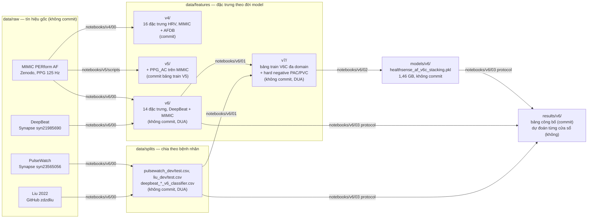

# Dữ liệu của HealthSense ML

Thư mục này đi theo dòng chảy dữ liệu: **tín hiệu thô → đặc trưng → tập chia theo bệnh nhân**. Mỗi tầng ghi rõ nguồn, notebook sinh ra và có được commit hay không. `MANIFEST.csv` (sinh bằng `python -m healthsense_ml.manifest`, chạy từ gốc repo với `PYTHONPATH=src`) liệt kê kích thước và SHA-256 của mọi tệp trong `data/`, `results/v6/`, `models/` để đối chiếu khi chép giữa các máy.

## Sơ đồ dòng dữ liệu

## Các tầng

| Thư mục | Nội dung | Sinh bởi | Commit? |
|---|---|---|---|
| `raw/mimic_perform/` | PPG + ECG gốc, 35 bệnh nhân, `af/` và `non-af/` | [Zenodo 6973963](https://zenodo.org/records/6973963) | Không, tải về |
| `raw/deepbeat/`, `raw/pulsewatch/`, `raw/liu2022/` | PPG gốc của ba domain còn lại | Synapse (cần tài khoản và DUA), GitHub zdzdliu | Không, tải về |
| `cache/` | memmap tín hiệu DeepBeat để trích đặc trưng nhanh | `notebooks/v6/00` | Không |
| `features/v4/` | `mimic_features_v4.csv`, `afdb_features_v4.csv`: 16 đặc trưng HRV cửa sổ 30 s | `notebooks/v4/00` (`src/healthsense_ml`) | **Có** |
| `features/v5/` | `af_features_cosen_ac.csv`: bảng train V5 trên MIMIC, thêm PPG_AC (commit); `af_specific_features.csv` trung gian và `afdb_features_v5_afib_only.csv` (không) | `notebooks/v5/scripts/build_*`, `src/healthsense_ml/afdb.py` | Một phần |
| `features/v6/` | DeepBeat train/validate/test và MIMIC, 14 đặc trưng (13 HRV + PPG_AC) | `notebooks/v6/00` | Không (DUA DeepBeat) |
| `features/v7/` | `healthsense_af_v6c_pacaware_train.csv` (137 476 cửa sổ, 248 bệnh nhân, 4 domain), `hard_negative_v7_v2.csv`, bảng V6B | `notebooks/v6/00`, `notebooks/v6/01` | Không (DUA PulseWatch) |
| `splits/` | DEV/TEST theo bệnh nhân của PulseWatch và Liu (kèm seed), manifest cửa sổ DeepBeat, SHA-256 nguồn | `notebooks/v6/00` | Không (DUA) |
| `sample/` | Vài tệp nhỏ để chạy test | Cắt từ MIMIC | **Có** |

## Vì sao không commit đặc trưng V6, V7 và splits

Không phải vì kích thước (tổng khoảng 150 MB) mà vì **thoả thuận sử dụng dữ liệu**: DeepBeat và PulseWatch phát hành trên Synapse với điều khoản không phân phối lại, và đặc trưng kèm mã bệnh nhân vẫn là dữ liệu dẫn xuất. Chia sẻ nội bộ qua ổ đĩa chung rồi đối chiếu SHA-256 trong `MANIFEST.csv`.

## Tái tạo từ đầu

1. Tải MIMIC PERform AF vào `raw/mimic_perform/`; xin quyền Synapse cho DeepBeat và PulseWatch; clone Liu 2022.
2. `notebooks/v4/00_prepare_features` → `features/v4/`.
3. `notebooks/v5/01_train_frozen_rf` → model V5; `notebooks/v5/02_external_validation` → `results/v5/` (đầu vào cho bước sau).
4. `notebooks/v6/00_extract_features_and_splits` → `features/v6/`, `splits/`; `notebooks/v6/01` → `features/v7/`; `notebooks/v6/02` → model V6C.
5. `notebooks/v6/03_locked_protocol` → `results/v6/`.
6. `python -m healthsense_ml.manifest` và so với `MANIFEST.csv` đã commit.

Máy hiện tại **chưa có** `raw/` của ba domain ngoài MIMIC, nên bước 3 (kiểm định ngoài) và 4 (trích đặc trưng) chỉ chạy được trên máy đã tải dữ liệu; `features/v6`, `v7`, `splits/` và `results/v5` ở đây là bản chép từ máy đó.
