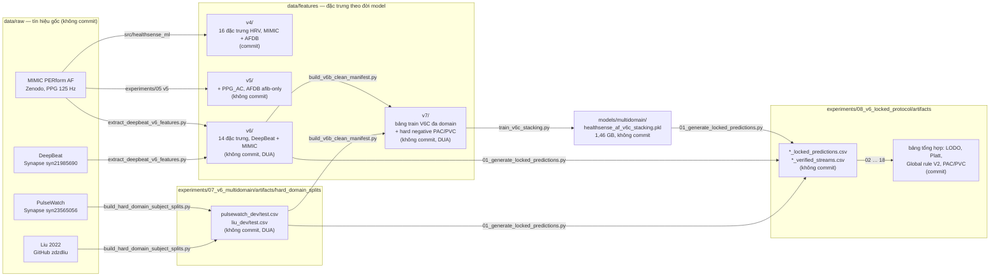

# Dữ liệu của HealthSense ML

Thư mục này đi theo dòng chảy dữ liệu: **tín hiệu thô → đặc trưng → tập chia theo bệnh nhân → dự đoán đã khoá**. Mỗi tầng ghi rõ nguồn, script sinh ra và có được commit hay không. Tệp `MANIFEST.csv` (sinh bằng `python scripts/make_data_manifest.py`) liệt kê kích thước và SHA-256 của mọi tệp để đối chiếu khi chép giữa các máy.

## Sơ đồ dòng dữ liệu

## Các tầng

| Thư mục | Nội dung | Nguồn / script sinh ra | Commit? |
|---|---|---|---|
| `raw/mimic_perform/` | PPG + ECG gốc, 35 bệnh nhân, `af/` và `non-af/` | [Zenodo 6973963](https://zenodo.org/records/6973963) | Không, tải về |
| `raw/deepbeat/`, `raw/pulsewatch/`, `raw/liu2022/` | PPG gốc của ba domain còn lại | Synapse (cần tài khoản và DUA), GitHub zdzdliu | Không, tải về |
| `features/v4/` | `mimic_features_v4.csv`, `afdb_features_v4.csv`: 16 đặc trưng HRV cửa sổ 30 s | `src/healthsense_ml/` (pipeline V4) | **Có** |
| `features/v5/` | `afdb_features_v5_afib_only.csv` | `src/healthsense_ml/afdb.py` | Không |
| `features/v6/` | DeepBeat train/validate/test và MIMIC, 14 đặc trưng (13 HRV + PPG_AC) | `experiments/07_v6_multidomain/extract_deepbeat_v6_features.py` | Không (DUA DeepBeat) |
| `features/v7/` | `healthsense_af_v6c_pacaware_train.csv` (137 476 cửa sổ, 248 bệnh nhân, 4 domain), `hard_negative_v7_*.csv`, các bảng train V6B | `build_v6b_manifest.py`, `build_v6b_clean_manifest.py` | Không (DUA PulseWatch) |
| `features/legacy/root_copies/` | Ba bản sao cũ từng nằm ở gốc `data/`, nội dung khác bản v4 đã commit, chưa rõ nguồn; xoá được sau khi đối chiếu | Không rõ | Không |
| `sample/` | Vài tệp nhỏ để chạy test và CI | Cắt từ MIMIC | **Có** |

Các tập DEV/TEST theo bệnh nhân của PulseWatch và Liu nằm ở `experiments/07_v6_multidomain/artifacts/hard_domain_splits/` vì toàn bộ script của protocol V6 đọc đường dẫn đó; dự đoán đã khoá nằm ở `experiments/08_v6_locked_protocol/artifacts/`. Hai nơi này không commit, chỉ commit các bảng tổng hợp.

## Vì sao không commit đặc trưng V6, V7

Không phải vì kích thước (tổng khoảng 100 MB) mà vì **thoả thuận sử dụng dữ liệu**: DeepBeat và PulseWatch phát hành trên Synapse với điều khoản không phân phối lại, và đặc trưng kèm mã bệnh nhân vẫn là dữ liệu dẫn xuất. Chia sẻ nội bộ qua ổ đĩa chung rồi đối chiếu SHA-256 trong `MANIFEST.csv`.

## Tái tạo từ đầu

1. Tải MIMIC PERform AF vào `raw/mimic_perform/`; xin quyền Synapse cho DeepBeat và PulseWatch; clone Liu 2022.
2. Chạy pipeline V4 trong `src/healthsense_ml/` để có `features/v4/`.
3. Chạy lần lượt các script trong `experiments/07_v6_multidomain/`: trích đặc trưng V6, dựng split theo bệnh nhân, dựng bảng train V7, huấn luyện V6C.
4. Chạy 18 script trong `experiments/08_v6_locked_protocol/` theo số thứ tự để sinh dự đoán đã khoá và các bảng tổng hợp.
5. Chạy `python scripts/make_data_manifest.py` và so với `MANIFEST.csv` đã commit.

Những gì máy hiện tại **chưa có**: `raw/` của ba domain ngoài MIMIC, `hard_domain_splits/`, `*_locked_predictions.csv` và tệp `.pkl` V6C. Xin từ máy đã huấn luyện V6 trước khi chạy lại bước 4.
